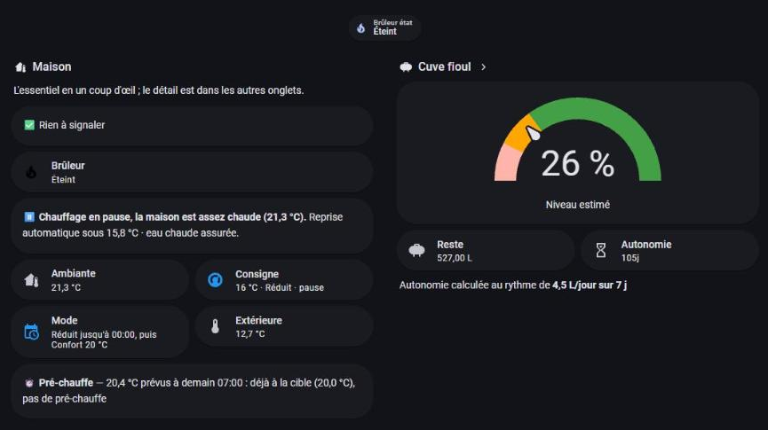

# Viessmann Vitorondens / Vitotronic 200 dans Home Assistant — kit Optolink + MQTT gratuit et chauffage intelligent

🇬🇧 [Read in English](README.md)

**Une solution efficace et gratuite pour relier une chaudière fioul Viessmann à Home Assistant.** Lire et (avec prudence) piloter une **Viessmann Vitorondens 222-F** avec régulation **Vitotronic 200 KO1B/KO2B** (identifiant `20CB…`) via un adaptateur **Optolink** USB, un Raspberry Pi, **MQTT** et [optolink-splitter](https://github.com/philippoo66/optolink-splitter) — puis ajouter un vrai **chauffage intelligent** (planning, pré-chauffe, présence, vacances, indicateur d'eau chaude, estimation du fioul).

> Ce n'est **pas un fork** et il ne contient aucun code d'optolink-splitter : c'est une poll list prête à l'emploi, un tableau des adresses validées / invalides, des YAML Home Assistant et des guides pas à pas.

*Le tableau de bord « vue d'ensemble » de la chaudière construit avec ce kit : brûleur, température ambiante, consigne du moment, mode du planning, prévision de pré-chauffe et niveau de fioul estimé. (Le chauffage est en pause ici car la maison est assez chaude.)*

## ☕ Soutenir le projet

Ce kit est gratuit. S'il vous a fait gagner du temps, un café fait très plaisir : **[buymeacoffee.com/soprez](https://buymeacoffee.com/soprez)**.

**Installateurs et chauffagistes :** ce kit vous fait gagner beaucoup de temps sur chaque chantier — tableau d'adresses déjà validé, câblage, service, MQTT et Home Assistant prêts à copier. Un café est bienvenu et permet de maintenir le projet.

## Contenu

| | |
|---|---|
| [`optolink/poll_list.py.example`](optolink/poll_list.py.example) | Poll list Home Assistant pour 20CB : ~30 entités (températures, brûleur, compteurs, pompes, mode, courbe de chauffe, consignes) |
| [`docs/addresses.md`](docs/addresses.md) | Adresses qui fonctionnent, invalides sur 20CB, et pièges (écriture acquittée mais ignorée, compteur de fioul toujours à 0, valeur de mode interdite…) |
| [`docs/guide.fr.md`](docs/guide.fr.md) | Matériel, câblage Optolink, udev, systemd, MQTT, Home Assistant, sécurité |
| [`docs/smart-heating.fr.md`](docs/smart-heating.fr.md) | Guide du **chauffage intelligent** : planning, pré-chauffe, présence/vacances, dérogation, priorité eau chaude, fioul, pertes du ballon, FAQ |
| [`ha/smart-heating/package_chauffage_intelligent.yaml`](ha/smart-heating/package_chauffage_intelligent.yaml) | Un package Home Assistant : helpers, capteurs, automatisations |
| [`ha/dhw_running.yaml`](ha/dhw_running.yaml) | Capteur **« Production d'eau chaude en cours »** (brûleur + pompe de charge 0x6513) avec heure de fin estimée |
| [`ha/fuel_estimate.yaml`](ha/fuel_estimate.yaml) | Estimation de la consommation de fioul par les heures du brûleur (le compteur de la chaudière reste à 0) |
| [`ha/publish_climate.py`](ha/publish_climate.py) | Découverte MQTT de deux thermostats (consignes confort / réduit) |
| [`ha/lovelace-example.yaml`](ha/lovelace-example.yaml) | Exemple de vue de tableau de bord |

## Le chauffage intelligent en bref
- **Planning dans Home Assistant** (Confort / Réduit) à la place du programme de la chaudière.
- **Pré-chauffe anticipée** selon la vitesse de chauffe mesurée de votre maison.
- **Coupure maison vide** (présence) et **calendriers de vacances** ; **dérogation** manuelle jusqu'au prochain créneau.
- **Priorité eau chaude** rendue visible : l'indicateur *« Eau chaude en cours »* avec heure de fin estimée.
- Courbe de chauffe (pente/niveau) laissée à la chaudière ; **estimation du fioul** avec compteurs jour/semaine/mois/année ; mesure des **pertes du ballon**.

→ Guide complet (mise en route, pièges, FAQ) : [docs/smart-heating.fr.md](docs/smart-heating.fr.md).

## Modèles compatibles
- **Validé :** Viessmann **Vitorondens 222-F** (fioul) avec **Vitotronic 200 KO1B/KO2B**, identifiant `20CB…`, protocole VS2 / « 300 ».
- **Probablement compatibles** (même famille de régulation dans les [tables openv](https://github.com/openv/openv/wiki/Adressen), *non testés ici*) : d'autres chaudières équipées d'une Vitotronic 200 KO1B/KO2B (par exemple Vitorondens 200-T, Vitoladens 300-C).
- **Autres générations de Vitotronic** (ex. chaudières gaz **Vitodens** avec HO1B/HO2B/B2HA…) : le câblage Optolink, optolink-splitter, MQTT et la couche Home Assistant s'appliquent, mais les adresses diffèrent — validez-les en lecture seule avec les tables openv avant toute écriture.
- Vérifiez d'abord votre identifiant d'appareil en 0x00F8. Dites-nous ce qui marche sur votre modèle en ouvrant une issue.

## Démarrage rapide
1. Suivez le [guide](docs/guide.fr.md) jusqu'au splitter qui tourne avec la poll list fournie.
2. Les entités apparaissent en `sensor.chaudiere_*`. Ajoutez [`ha/dhw_running.yaml`](ha/dhw_running.yaml) pour l'indicateur d'eau chaude.
3. Commencez en **lecture seule** ; ajoutez les écritures (mode, consignes) quand les lectures vous inspirent confiance, puis essayez le [chauffage intelligent](docs/smart-heating.fr.md).

## ⚠️ Sécurité
Écrire dans la régulation peut couper le chauffage ou modifier des consignes sensibles. La valeur de mode `3` sur 0x2323 coupe tout ; la consigne ECS est plafonnée à 60 °C par la régulation. Lisez [la section sécurité](docs/guide.fr.md#8-sécurité--à-lire-avant-toute-écriture). À vos risques ; aucun lien avec Viessmann.

## Crédits et liens
- [philippoo66/optolink-splitter](https://github.com/philippoo66/optolink-splitter) — le pont Optolink ↔ MQTT qui fait tout le travail (GPL-3.0). Son format de poll list est utilisé ici.
- [openv/openv wiki — Adressen](https://github.com/openv/openv/wiki/Adressen) — tables d'adresses communautaires (issue 377 : écritures Spar/Party sur 20CB).
- [openv/vcontrold](https://github.com/openv/vcontrold) (`xml/300/vito.xml` ; issue 131 : donnée de consommation de fioul).

## Licence
[GPL-3.0 ou ultérieure](LICENSE). optolink-splitter est sous GPL-3.0 ; la poll list est écrite dans son format et suit donc la même licence. Les autres fichiers sont publiés sous la même licence par simplicité.
