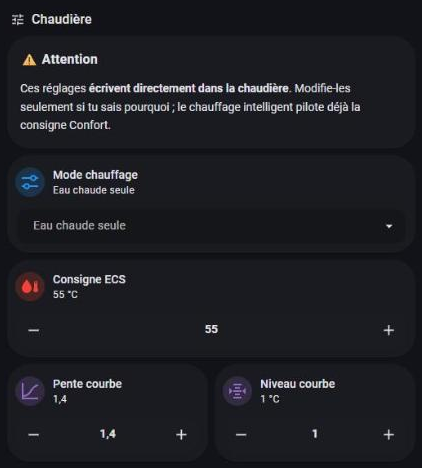
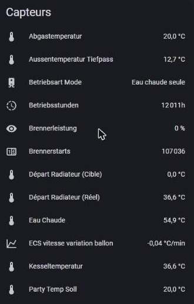
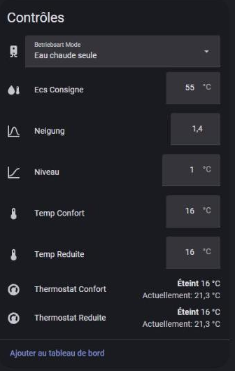

# Step-by-step guide (English)

Français : [guide.fr.md](guide.fr.md)

## 1. Hardware
- A Viessmann boiler with a **Vitotronic 200 KO1B/KO2B** (checked here on a Vitorondens 222-F, oil). Read the device ID at 0x00F8: this kit targets IDs starting with `20CB`.
- An **Optolink USB adapter** (infra-red head that clips on the optical port of the regulation). The one used here has a CH340 USB-serial chip. Any equivalent Optolink-to-USB head works.
- A small always-on Linux computer (Raspberry Pi) close to the boiler, and a Home Assistant instance with the Mosquitto broker add-on.

## 2. Wiring
1. Clip the Optolink head on the optical window of the Vitotronic (magnets/ring: the LED side faces the window, the cable goes downward).
2. Plug the USB side into the Pi. `dmesg | grep -i ch341` should show a `ttyUSB0`.
3. Optolink serial parameters: **4800 baud, 8 data bits, even parity, 2 stop bits (8E2)**, protocol VS2 ("300").

## 3. Stable device name (udev)
`/etc/udev/rules.d/99-optolink.rules`:
```
SUBSYSTEM=="tty", ATTRS{idVendor}=="1a86", ATTRS{idProduct}=="7523", SYMLINK+="vitocom"
```
Then `sudo udevadm control --reload && sudo udevadm trigger`; the port is now `/dev/vitocom`.

## 4. Install optolink-splitter (not included here)
```
git clone https://github.com/philippoo66/optolink-splitter.git
cd optolink-splitter
python3 -m venv venv && venv/bin/pip install -r requirements.txt
cp settings_ini.py.example settings_ini.py
```
Edit `settings_ini.py` following the upstream comments: serial port `/dev/vitocom`, 4800 8E2 / VS2, the MQTT broker (`host:port`) and credentials (`user:password`) of your Home Assistant Mosquitto, and the topic prefix. Use the **MQTT user you created for it**, never your HA account.

## 5. Poll list
Copy [`optolink/poll_list.py.example`](../optolink/poll_list.py.example) into the splitter directory under the name your `settings_ini.py` points to (e.g. `homeassistant_poll_list.py`). Keep only the entries you want; **delete the `number` / `select` blocks if you want a read-only setup**. The list uses MQTT Home Assistant discovery: entities appear automatically as `sensor.chaudiere_*`.

## 6. systemd service
`/etc/systemd/system/optolink-splitter.service`:
```
[Unit]
Description=Optolink splitter
After=network-online.target
Wants=network-online.target

[Service]
User=<your-linux-user>
WorkingDirectory=/home/<your-linux-user>/optolink-splitter
ExecStart=/home/<your-linux-user>/optolink-splitter/venv/bin/python3 main.py
Restart=always
RestartSec=10

[Install]
WantedBy=multi-user.target
```
`sudo systemctl daemon-reload && sudo systemctl enable --now optolink-splitter` and follow with `journalctl -fu optolink-splitter`. (Entry-point name: check the upstream README.)

## 7. MQTT and Home Assistant
1. In HA: Mosquitto broker add-on + MQTT integration, and a dedicated MQTT user.
2. Check with MQTT Explorer or *Settings > Devices > MQTT > Configure* that `chaudiere/#` receives values.
3. Optional thermostats: `MQTT_PASSWORD=… python3 ha/publish_climate.py` (publishes two retained climate discovery configs).
4. Add the helpers/templates from [`ha/`](../ha): `dhw_running.yaml` (hot-water indicator), `fuel_estimate.yaml`, and the example view `lovelace-example.yaml`.


*A settings card for the writable datapoints: mode (0x2323), hot-water setpoint (0x6300), heating-curve slope (0x27D3) and level (0x27D4). Write access: see the safety section below.*


*Sensors discovered automatically: flue gas, outside, boiler and hot-water temperatures, burner hours (0x08A7), burner starts (0x088A), modulation (0xA38F), flow actual/target.*


*Controls discovered automatically over MQTT: operating mode, hot-water setpoint (0x6300), heating-curve slope and level (0x27D3/0x27D4), comfort/reduced setpoints (0x2306/0x2307) and the two thermostats. (The mode reads "hot water only" because heating was paused by the smart-heating logic.)*

## 8. Safety — read before writing anything
- **Start read-only.** Reading is harmless; writing changes the regulation of a heating system.
- Mode (0x2323): only **1** (hot water only) and **2** (heating + hot water). **Never 3** (switches everything off).
- DHW setpoint (0x6300): maximum 60 °C (the regulation refuses more). Mind legionella and scalding limits.
- Spar/Party writes (0x2302/0x2303) do nothing on 20CB; do not rely on them.
- Do not poll faster than the splitter default; the Optolink is a slow serial link shared with the regulation.
- Keep the Vitotronic display as the source of truth; a wrong HA automation must never be the only thing between you and a cold house.
- Use at your own risk; no relation with Viessmann.
