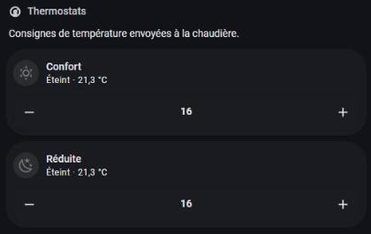
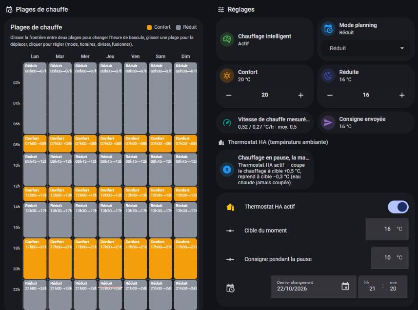
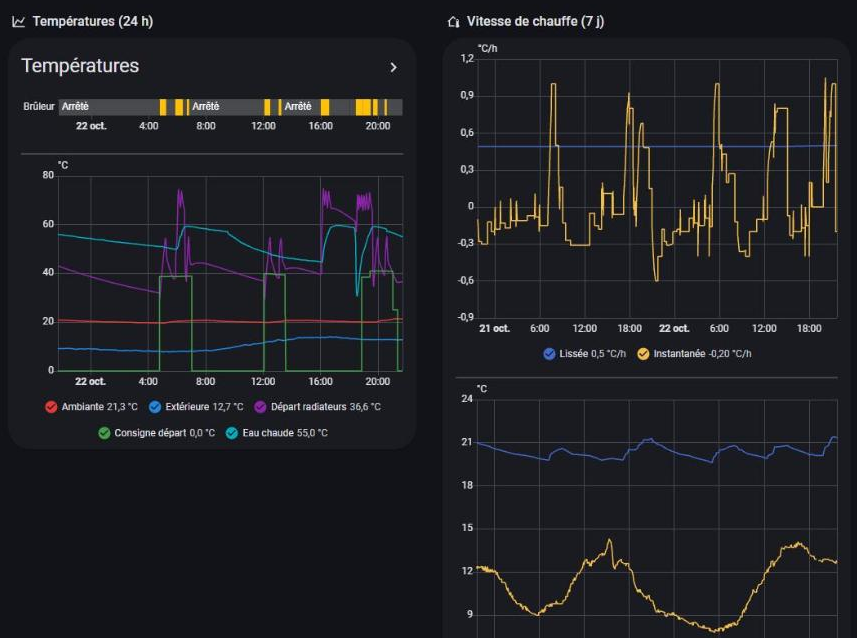
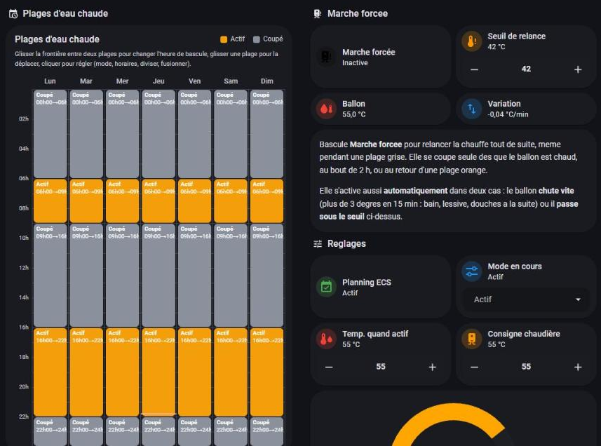

# Smart heating with a Viessmann boiler (user guide)

Français : [smart-heating.fr.md](smart-heating.fr.md)

This guide describes a **smart heating** setup built on this kit: Home Assistant drives the room setpoints of the Vitotronic 200 (Vitorondens, oil) instead of its timer program, learns how fast the house heats up, switches to reduced when everybody is away, respects hot-water priority and estimates oil consumption. It is **free** and reproducible from the files in this repo: [`ha/smart-heating/package_chauffage_intelligent.yaml`](../ha/smart-heating/package_chauffage_intelligent.yaml) (one package: helpers, sensors, automations) and [`ha/dhw_running.yaml`](../ha/dhw_running.yaml).

> The YAML comes from a real installation (Vitorondens 222-F) and was generalised (example names and calendars). **Test with the automations disabled**, watch the logbook, and keep the boiler display as the reference.

*Overview dashboard: the pre-heating line shows the forecast for the next Comfort slot (target, degrees to gain, estimated duration and start time).*

## What you get
- **Comfort**: the house is at the right temperature *at the right time* (pre-heating), not two hours later.
- **Savings**: reduced setpoint when nobody is home, holiday cut-off, no needless overheating; oil use visible per day/week/month/year.
- **Visibility**: what the boiler is doing (burner, hot water in progress, tank losses) at a glance.

## How it works, block by block

### 1. Comfort / Reduced planning in Home Assistant
A `schedule` helper (`schedule.chauffage_confort`) replaces the boiler's timer: *on* = Comfort, *off* = Reduced. Edit it in the UI (several slots per day). The automation **"Chauffage intelligent - planning"** computes the current target and writes **both** boiler setpoints (normal 0x2306 and reduced 0x2307): the boiler follows the setpoint of its own time phase, so they must be identical, otherwise the Vitotronic's internal "reduced" phase takes over.

> ⚠️ The Vitotronic accepts **whole degrees** only for these setpoints. The exact target (19.5) is rounded up (20) before writing.

*The two thermostats (comfort and reduced) show the setpoints written to the boiler (here 16 °C) and the current room temperature.*

*Weekly planning (orange = Comfort, grey = Reduced) next to the smart-heating settings: Comfort 20 °C, Reduced 16 °C, learned heating speed, setpoint sent to the boiler.*

### 2. Early pre-heating
The measured heating speed (°C/h) gives *how long before* the Comfort slot heating must start: `(target − room) / speed`. A **latch** ("pre-heating in progress") prevents flip-flopping when the temperature hovers around the target: pre-heating starts if the gap exceeds 0.2 °C inside the lead window, then stays on until the Comfort slot. `sensor.chauffage_avance_pre_chauffe` shows the computed lead (capped by "maximum lead").

The speed is **learned** by the "heating speed measurement" automation: at every setpoint rise of at least 0.5 °C it measures the real rise until the target (6 h max) and updates the speed with a 70/30 exponential average. The initial value (0.5 °C/h) is rough: give it a few days.

*Left: 24 h curves — burner runs (yellow), hot-water temperature (cyan) rising during charging, radiator flow (purple), ambient (red). Right: instantaneous and learned heating speed (°C/h) over 7 days.*

### 3. Empty house and holidays
Two cases cut Comfort (the target falls back to Reduced, pre-heating included):
- **presence**: `zone.home` is 0 (nobody in the home zone);
- **holiday calendars**: one calendar per person (Google, local…) where an all-day event means *away*. The house is "empty" when **all** calendars are on. The kit ships two example calendars (`calendar.vacances_occupant_1`, `_2`) — replace them with yours.

### 4. Manual override
Manually changing the **current setpoint** (widget, app or UI) raises an *override*: the target becomes that value until the **next Comfort/Reduced slot change**, or until you switch the "Override active" boolean off. During pre-heating the target is the maximum of the override and Comfort. The override is ignored while the house is empty.

### 5. Hot-water priority and the "Hot water in progress" indicator
The Vitotronic gives **priority to hot-water production** by default (a regulation parameter, check yours): while the tank charges (charge pump 0x6513 = 1, burner on) the heating circuit steps back. That is why raising the setpoint in the evening (when the tank often heats) seems to "do nothing" for a while. [`binary_sensor.production_d_eau_chaude_en_cours`](../ha/dhw_running.yaml) shows it, with an **estimated end time** (`fin_estimee`, from the 0x6300 setpoint and the tank temperature rise rate). Make it a conditional card at the top of your dashboard ([example](../ha/lovelace-example.yaml)).

Other hot-water automations in the package: DHW setpoint planning (0x6300 = wanted temperature, or 10 °C to switch off), **automatic restart** when the tank drops fast during an OFF slot (large draw-off), end of forced run.

*Hot-water planning (orange = active, grey = off), forced run, relaunch threshold and the tank temperature/variation: the relaunch automation restarts production after a large draw-off.*

### 6. Heating curve left to the boiler
The **heating curve** slope (0x27D3) and level (0x27D4) stay under the boiler's weather-compensated control. The kit exposes them for fine tuning, but smart heating never changes them: it only acts on room setpoints. Rule of thumb: if the house is too cold *only in hard frost*, raise the slope; if it is too warm/cold everywhere, change the level.

*Heating-curve slope (1.4) and level (1) as exposed by the kit; smart heating never changes them.*

### 7. Oil consumption and per-period counters
The boiler's own fuel counter (0x7574) stays at 0 without a flow meter. The kit **estimates** it: burner hours (0x08A7) × nominal burner flow (nameplate, kg/h) ÷ density (0.84 kg/L), see [`ha/fuel_estimate.yaml`](../ha/fuel_estimate.yaml). The package adds day / week / month / year counters (`utility_meter`). Re-calibrate with real deliveries (± 15 % is typical).

### 8. Measured tank losses
`sensor.eau_chaude_bilan_ballon` (°C/h) = rise during charging − losses. Losses depend on the gap to the room and are tuned with `input_number.ecs_pertes_ballon` (°C/h lost when the tank is 32 °C above the room). To measure: switch production off overnight, note the temperature drop between midnight and morning with no draw-off, and adjust until the night balance matches the real drop. `sensor.eau_chaude_tiree_estimee` estimates litres drawn (temperature drop since midnight, tank volume, tap and cold-water temperatures).
**Tips**: an indicative figure for a well-insulated tank is 0.3–0.6 °C/h (measure yours); lowering the DHW setpoint by 5 °C cuts losses and oil; switching DHW off at night only pays off if losses are high (the morning restart compensates).

## Step by step
1. Install the kit ([guide](guide.md)): the `*.chaudiere_*` entities must exist.
2. Add [`ha/dhw_running.yaml`](../ha/dhw_running.yaml) and [`ha/fuel_estimate.yaml`](../ha/fuel_estimate.yaml).
3. Copy the package into `packages/` (see the file header to enable packages), replace the calendars, restart Home Assistant.
4. **Disable** the package automations, set the Comfort / Reduced targets and the planning.
5. Write down the boiler's original setpoints (0x2306 / 0x2307) so you can go back.
6. Switch "Smart heating active" on, watch the logbook for 2–3 days, then enable the speed measurement.

## Pitfalls
- **Operating mode (betriebsart)**: only 1 (hot water only) and 2 (heating + hot water) are safe on 0x2323. **Never 3** (switches everything off). Smart heating does not touch the mode.
- **Spar / Party** (0x2302 / 0x2303): writes are ACKed but **ignored** on 20CB (openv issue 377). Do not build an "eco" or "party" feature on them.
- **Whole-degree** setpoints only; a stale read echo right after a write (the bridge re-reads the old value for ~30 s): do not trigger "manual change" logic on a value that just changed without a 60 s stability check.
- 0x6500 (current DHW setpoint) is unreliable: use 0x6300.
- The charge pump 0x6513 is read every ~30 min by default: put it in the `OFTEN` group (see the kit's poll list).
- Safety: read-only first; see [the safety section](guide.md#8-safety--read-before-writing-anything).

## FAQ
**Why not the boiler's own program?** It knows neither presence, holidays nor the real heating speed of your house.
**Does it work on my Vitodens / gas boiler?** The principle does; the addresses are those of the Vitotronic 200 KO1B/KO2B (20CB) regulation and may differ: validate them read-only.
**What if Home Assistant crashes?** The setpoints stay written in the boiler (autonomous regulation), which keeps running with the last value.
**Can I go back to the original program?** Yes: switch "Smart heating active" off and restore the original setpoints.
**Hot water goes before heating — is that a fault?** No, it is the normal Vitotronic priority; the indicator makes it visible.
**How long until pre-heating is accurate?** A few measurements (a few days) to learn the speed.
